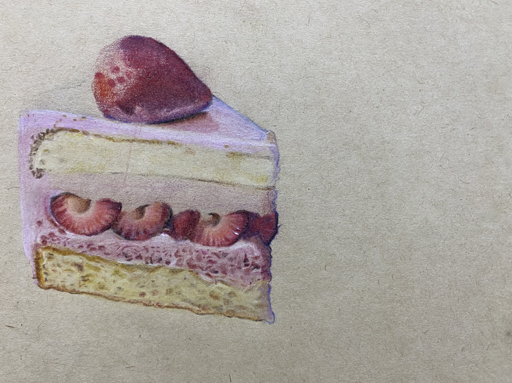
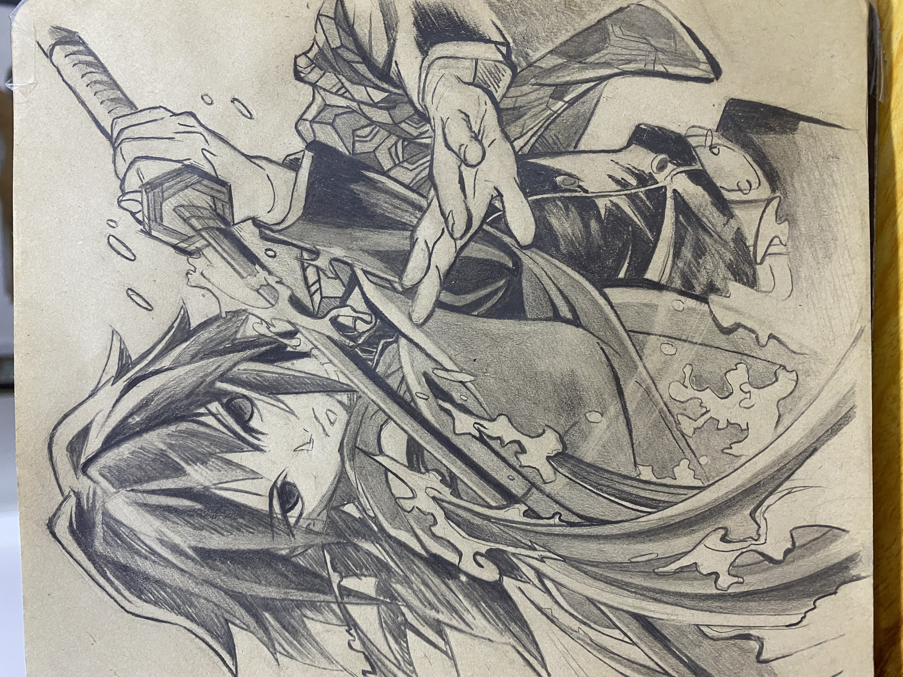
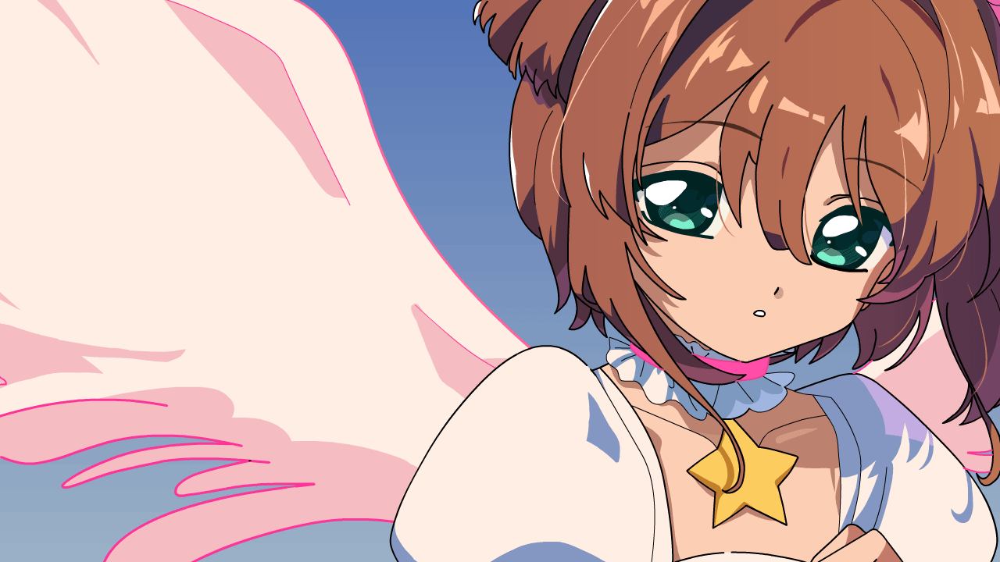
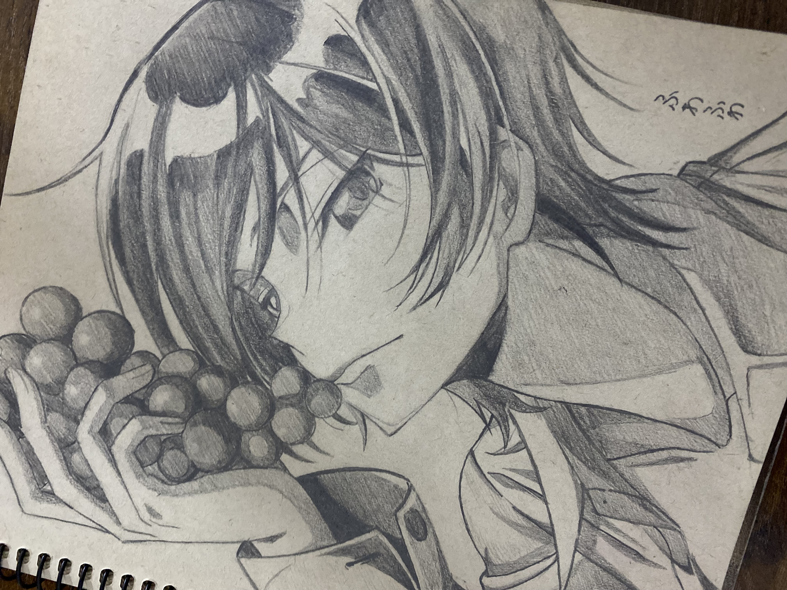
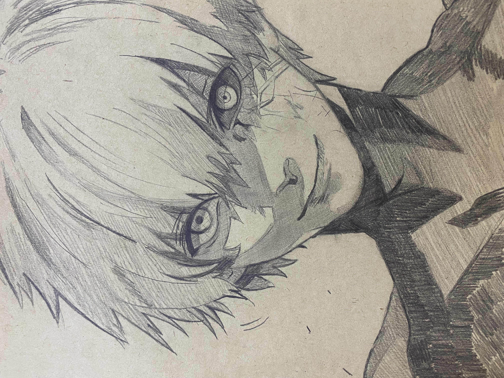
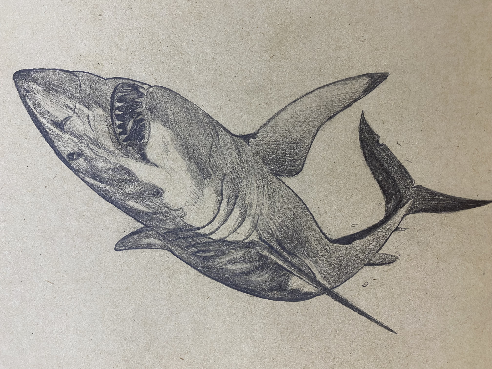
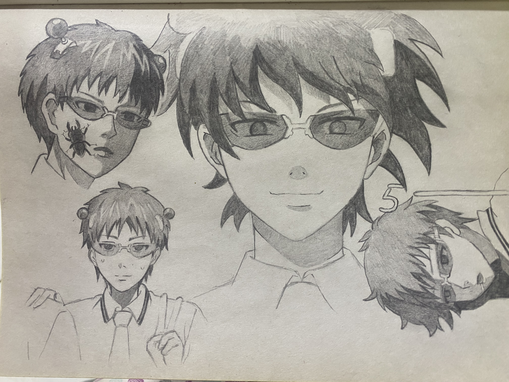

# digital-traditional-arts
# Strawberry Slice

A vibrant study of form and texture, capturing the intricate layers and natural lighting of a favorite pastry.
# Raw Egg

A still life study capturing the texture and lighting contrast of a raw egg.
# Tomioka Giyu

A fan art of water hashira
# Angle

My first digital drawing on my laptop
# Lelouch 

If the king doesn't move, then his subjects won't follow.
# Kaneki Ken

A fan art of ken kaneki.
# Twisted

A detailed pencil study of a shark turning upward. I wanted to capture the strong curve of the body and the tension in the jaw, using the mid-tone paper to build up the contrast between the sharp highlights and deep shadows.
# Coffee Jelly

Saiki K. in different poses and expressions
